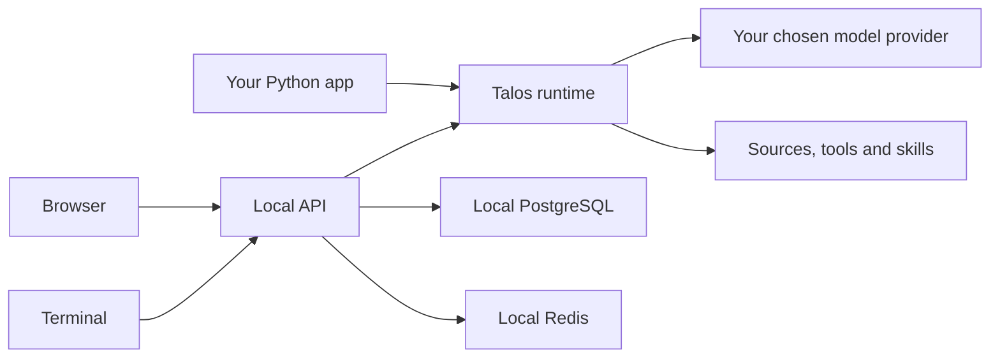

# TalosAI

**Ask questions about your code, inspect the sources, and use the same agent in Python, your terminal, or your browser.**

[](https://github.com/SamarthKumar3/TalosAI/actions/workflows/ci.yml)
[](https://pypi.org/project/talos-runtime/)
[](LICENSE)

[Website](https://talos-showcase.vercel.app) · [Python package](https://pypi.org/project/talos-runtime/) · [Report a bug](https://github.com/SamarthKumar3/TalosAI/issues)

Talos is for developers who want a local assistant with source citations, their own tools,
and a record of what happened during a reply. Start with the Python package, or use the
terminal and browser with local Docker services. You bring your own model API key.

**Early release:** the published SDK is `talos-runtime 0.1.0`. Repository Intel and other
newer source changes are available on GitHub `main`; they may not be in that PyPI version.
Windows is the tested development platform. Full first-time setup on Mac and Linux still
needs validation.

[Why Talos?](#why-talos) · [Python quickstart](#python-quickstart) · [Terminal and browser](#terminal-and-browser) · [Repository Intel](#ask-about-a-repository) · [Troubleshooting](#when-something-goes-wrong) · [Contributing](#help-improve-talos)

## Why Talos?

| What you want to do | What Talos provides |
| --- | --- |
| Understand an unfamiliar repository | Ask about a local checkout or GitHub repository, with file and line references. |
| Map how an application fits together | Ask for a high-level design and save a Mermaid diagram. |
| Ask questions about your documents | Search indexed files and inspect the sources used in an answer. |
| Add a task the assistant can perform | Add tools and Markdown skills through Settings or the CLI. |
| Understand an unexpected reply | Use `/why`, run traces, and `talos doctor` to inspect recorded evidence and setup. |
| Build the agent into a Python app | Use `TalosAgent` without running Docker or a browser. |

Talos brings these features into one local workspace. It is currently best suited to
individual developers trying repository and document workflows. It is an early release;
retrieval can miss relevant files, and answers and diagrams need your review.

## Choose how to run it

| Mode | Install | Requirements |
| --- | --- | --- |
| Python SDK | `python -m pip install talos-runtime` | Python 3.12 or newer. No clone, Docker, or browser needed. |
| Terminal | Download this repo, then `python -m pip install ".[cli]"` | Python 3.12, Docker Desktop with Linux containers and Compose. |
| Browser | Same installation as terminal mode; run `talos ui` | Same requirements as terminal mode. Node.js is not needed for normal use. |

The app runs locally; the default AI model is hosted by OpenRouter. Internet access and a
model key are needed for real answers, and provider charges may apply. Talos does not
include a local language model. You can check the SDK offline using the fixed response below.

## Python quickstart

Create and activate a virtual environment first:

```sh
python -m venv .venv
```

Windows PowerShell:

```powershell
.\.venv\Scripts\Activate.ps1
```

Mac/Linux shells:

```sh
source .venv/bin/activate
```

Install the published package and create a project:

```sh
python -m pip install --upgrade pip
python -m pip install talos-runtime
talos init my-agent
cd my-agent
```

Save this as `hello.py`:

```python
import asyncio
from getpass import getpass

from dotenv import dotenv_values
from talos import TalosAgent


async def main():
    settings = {
        key: value for key, value in dotenv_values(".env.example").items() if value is not None
    }
    settings["OPENROUTER_API_KEY"] = getpass("OpenRouter API key: ")
    agent = TalosAgent.from_config("talos.yaml", environment=settings)
    answer = await agent.run("Explain what an AI agent is in two sentences.")
    print(answer.response)


asyncio.run(main())
```

Run it:

```sh
python hello.py
```

<details>
<summary>Check the SDK without a key or network call</summary>

After `talos init my-agent`, save this as `offline.py` inside `my-agent`:

```python
import asyncio

from dotenv import dotenv_values
from talos import FakeModelProvider, TalosAgent


async def main():
    settings = {
        key: value for key, value in dotenv_values(".env.example").items() if value is not None
    }
    agent = TalosAgent.from_config(
        "talos.yaml",
        environment=settings,
        provider=FakeModelProvider("Talos is ready."),
    )
    answer = await agent.run("Check my setup.")
    print(answer.response)


asyncio.run(main())
```

Run `python offline.py`. Expected output:

```text
Talos is ready.
```

This is a fixed test response, not an AI answer. Installing the package still needs
Internet access unless its dependencies are already available.

</details>

### Optional Python features

The base SDK installs its core dependencies. Add only the extras you need:

| Feature | Installation |
| --- | --- |
| PDF reading | `python -m pip install "talos-runtime[pdf]"` |
| Custom branching workflows | `python -m pip install "talos-runtime[graph]"` |
| Send traces to an external service | `python -m pip install "talos-runtime[telemetry]"` |

The default SDK keeps conversations and run records in memory for the life of the agent.
Local Docker services provide saved chat history for terminal and browser use.

## Terminal and browser

Install Python 3.12 and start Docker Desktop with Linux containers and Compose enabled.
[Download the source ZIP](https://github.com/SamarthKumar3/TalosAI/archive/refs/heads/main.zip)
and extract it, or clone it:

```sh
git clone https://github.com/SamarthKumar3/TalosAI.git
cd TalosAI
```

Open a terminal in the extracted or cloned folder. Create and activate `.venv` using the
steps above, then run:

```sh
python -m pip install ".[cli]"
cp talos.example.yaml talos.yaml
```

`cp` also works in PowerShell. Keep your own `talos.yaml` when updating Talos.

### Start in the terminal

```sh
hi talos
```

On first use, Talos asks for an [OpenRouter API key](https://openrouter.ai/settings/keys).
Your typing is hidden and the key is saved in your computer's credential store.
The default model is `openai/gpt-4o-mini`; provider charges may apply.
The first start downloads and builds local services, so allow a few minutes.

Type a question and press Enter. Use `/help` for commands, `/new` for a fresh chat,
`/why` to inspect the last answer, and `/exit` to leave. Ctrl+C cancels a response.

### Start in the browser

```sh
talos ui
```

Talos asks for a key if needed and opens the browser when ready. If it does not open,
visit [localhost:3000](http://127.0.0.1:3000).

In Settings, **Runtime** lets you add model keys and models, then refresh the model list.
Choose a model beside the microphone in chat. Settings also provides tools, skills,
run traces, appearance, and **Debug → Run Talos Doctor**. Switching models starts a new chat.

Closing the browser or terminal keeps your chats and local services.
Use `talos stop` to stop the services without deleting data. Run one local Talos
installation at a time; it uses ports 3000 and 8000.

## Add tools and skills

In the browser, open Settings and use the tool or skill form.
In the terminal, import your own files:

```sh
talos tools add path/to/tool.yaml
talos skills add path/to/skill.md
talos tools --help
talos skills --help
```

YAML tools support limited text formatting and arithmetic. Skills are Markdown
instructions that guide the assistant. Review files before importing them.
For reviewed Python tools, build their separate sandbox first:

```sh
docker build -f Dockerfile.sandbox -t talos-tool-sandbox:1 .
talos tools add --help
```

Python tools require explicit trust and a matching file hash. They run in a
restricted Docker container. SDK callables registered directly by your app
run with your app's permissions.

## Ask about a repository

In the browser, select **+ → Repository Intel**, paste a GitHub repository URL,
and send your question. Talos remembers that repository for the chat. Ask for an
HLD to get a Mermaid diagram and download it as a `.mmd` file. Source chips show
which files were used; hover or focus a chip to see its full path.

For a private repository, open **Private repository?** and enter a fine-grained
GitHub token with **Contents: read-only** access to that repository. The token is
used once for the import and is not saved. Your chosen model receives source excerpts.

In the terminal, first index a local checkout or GitHub URL:

```sh
talos repo index https://github.com/owner/repository --yes
talos repo status JOB_ID
talos repo ask "Where does a request enter the app?" --path https://github.com/owner/repository
talos repo hld --path https://github.com/owner/repository
```

Wait for the indexing job to finish before asking. Add `--private` to the index
command to enter a GitHub token in a hidden prompt. In `hi talos`, use
`/repo index PATH_OR_URL`, then ask questions normally or run `/repo hld`.
Diagrams and cited explanations are saved under `.talos/artifacts/`. Open the
`.mmd` file in a Mermaid viewer such as [Mermaid Live](https://mermaid.live).
Check what you share before opening a private repository diagram in an online service.

## Your data

Talos runs locally. Your chosen AI provider receives the messages, selected file
excerpts, and tool results needed to answer. Check that provider's privacy terms.
Optional voice input may send audio to your browser's speech service.

In terminal and browser mode, chats and run records stay in the local database.
Stopping Talos preserves them; there is no complete erase-all button.
Backups and providers can retain copies.
CLI keys use the computer's credential store; browser-added keys use encrypted
local files. Protect the files and backups. Keep `.env`, `talos.yaml`, `.talos/`,
and imported files private. Use the browser on this computer only; this setup is
for one trusted user and is not ready to be exposed to the Internet.

## When something goes wrong

- Run `talos doctor` or Settings → Debug → Run Talos Doctor to check setup.
  Run `talos status` to check services.
- Start Docker Desktop if Talos cannot reach Docker.
- Run `talos logs --help` for service logs. Remove private information before sharing logs.
- For failed or slow answers, check Settings → Traces, your model key, provider availability,
  and usage limits. Retry in a new chat after fixing the cause.
- If PowerShell blocks environment activation, use `.\.venv\Scripts\python.exe`
  and `.\.venv\Scripts\talos.exe` directly instead of changing system policy.
- If a key leaks, revoke it at the provider and replace it in Talos.

## How the pieces fit together



The SDK runs inside your Python process. Terminal and browser mode use local API,
worker, database and queue services. Reviewed Python file tools use a separate Docker
sandbox. Local hosting does not mean your prompts stay offline: see [Your data](#your-data).

## Common questions

**Do I need to clone this repo for the SDK?** No. Install `talos-runtime` from PyPI,
then run `talos init` to create a project. Terminal and browser mode need the source folder.

**Can I use private GitHub repositories?** Yes, through a one-time token with Contents
read access. GitHub sign-in through OAuth is not included. Imports support repository-root
URLs and the default branch; large repositories can exceed the indexing limits.

**Does `/why` reveal the model's private reasoning?** No. It explains recorded execution
evidence, such as tools, sources, configuration and usage, when that evidence is available.

**Is it ready for a shared Internet-facing service?** This setup is for one trusted local
user. Do not expose it as a hosted multi-user service. There is no measured minimum RAM
or disk requirement yet; Docker builds need more space than the SDK alone.

**Why does GitHub have features I don't see in my installed SDK?** PyPI contains the
published version; GitHub `main` can contain newer changes. Updating this README does
not update the package installed from PyPI.

## Help improve Talos

[Open an issue](https://github.com/SamarthKumar3/TalosAI/issues) for a bug, setup problem,
or feature suggestion. Include your OS, Python version, Talos version or commit,
steps to reproduce, and what you expected. Remove credentials and private content.

Useful first contributions include checking Mac/Linux setup, improving examples,
reporting citation failures with a small public repository, and fixing unclear error messages.
For larger changes, discuss the approach in an issue first. Send focused pull requests
with reproduction steps and the checks you ran; use synthetic or public sample data.

Python code is in `src/talos/`, the browser app in `apps/web/`, and local service setup
in `docker-compose.dev.yaml`. For Python changes, start with `python -m pip install ".[dev]"`,
then run `python -m ruff check src migrations`, `python -m ruff format --check src migrations`,
and `python -m mypy`. Browser changes need Node.js; run `npm ci`, `npm run typecheck`,
`npm run lint`, and `npm run build` from `apps/web`. Pull requests run the repository's
source checks automatically.

Do not post security vulnerabilities or secrets in public issues. Use
[private vulnerability reporting](https://github.com/SamarthKumar3/TalosAI/security/advisories/new)
if enabled. Otherwise, contact [the maintainer](https://github.com/SamarthKumar3) to arrange
a private channel before sharing details.

If Talos helps you, a star makes it easier to find again. Feedback about a real task you
tried is especially useful while the project is young.

## License

TalosAI is licensed under [Apache 2.0](LICENSE). See [NOTICE](NOTICE).
